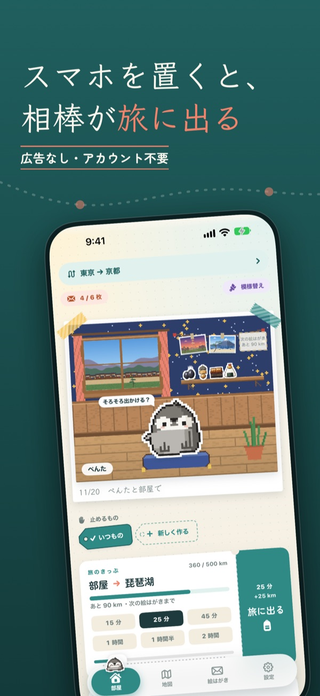
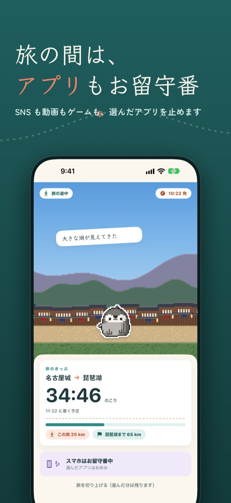
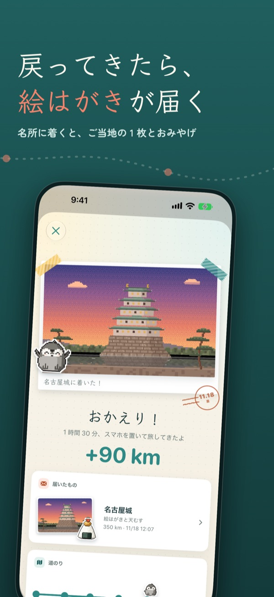
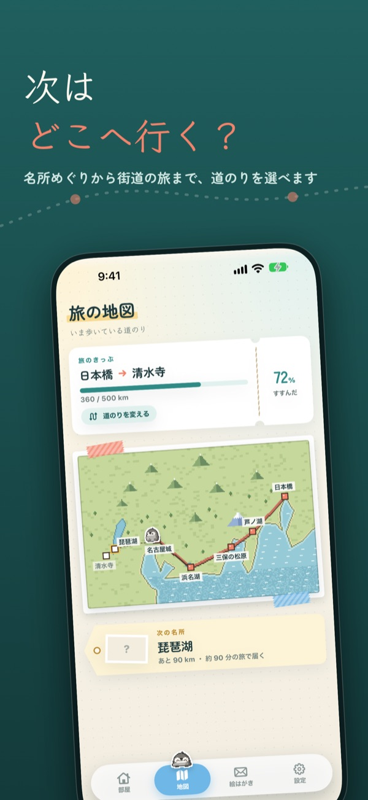
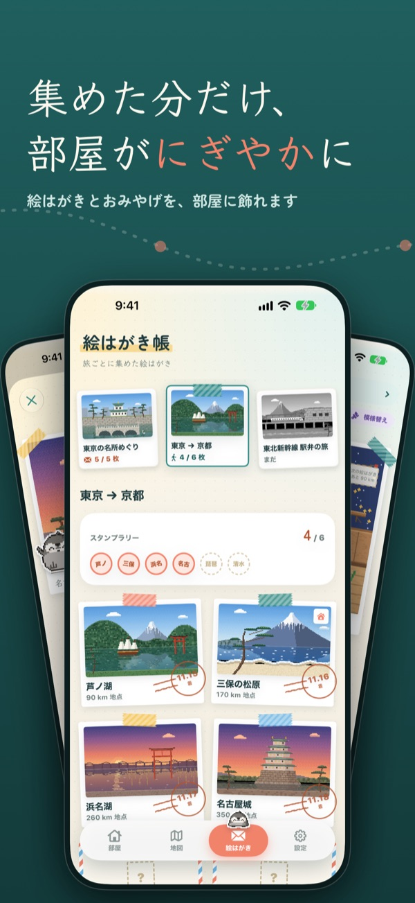

# unscroll-support

スマホ断ちのアプリ「おるすマホ」のサポートページとプライバシーポリシー。

## ✨ 機能

| 部屋 | 旅の途中 | おかえり |
| :---: | :---: | :---: |
|  |  |  |

| 旅の地図 | 絵はがき帳 |
| :---: | :---: |
|  |  |

## 🗺️ 全体像

| ページ | ファイル | 中身 |
| --- | --- | --- |
| [サポート](https://yossibank.github.io/unscroll-support/) | `index.html` | よくある質問と、お問い合わせのフォーム |
| [プライバシーポリシー](https://yossibank.github.io/unscroll-support/privacy.html) | `privacy.html` | 集める情報と、データの保存先 |
| 公開の仕方 | GitHub Pages | `main` のファイルをそのまま公開 |
| アプリの本体 | 非公開のリポジトリ | |
